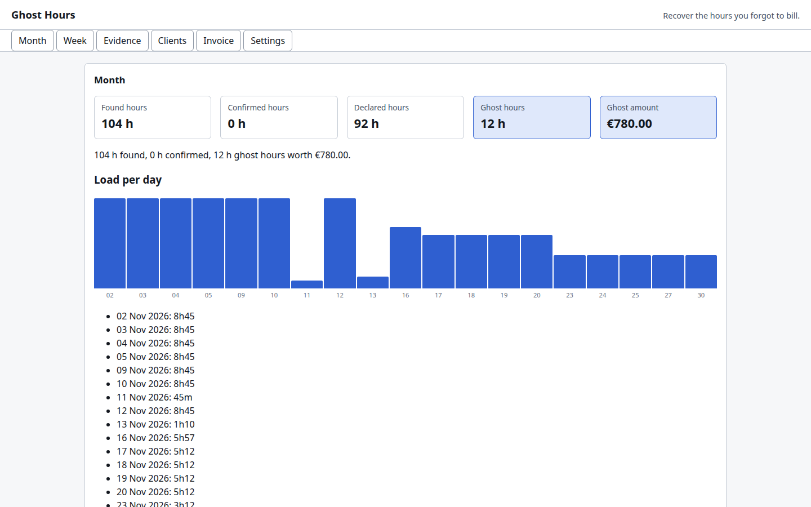
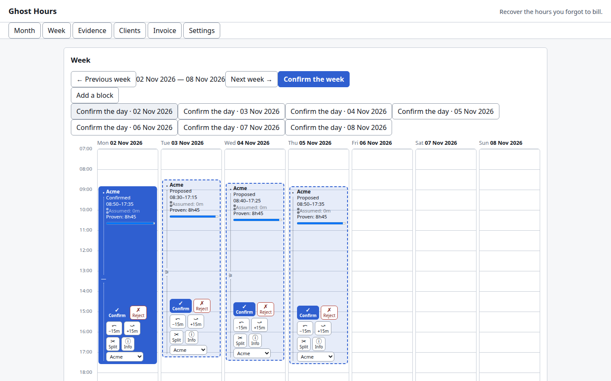
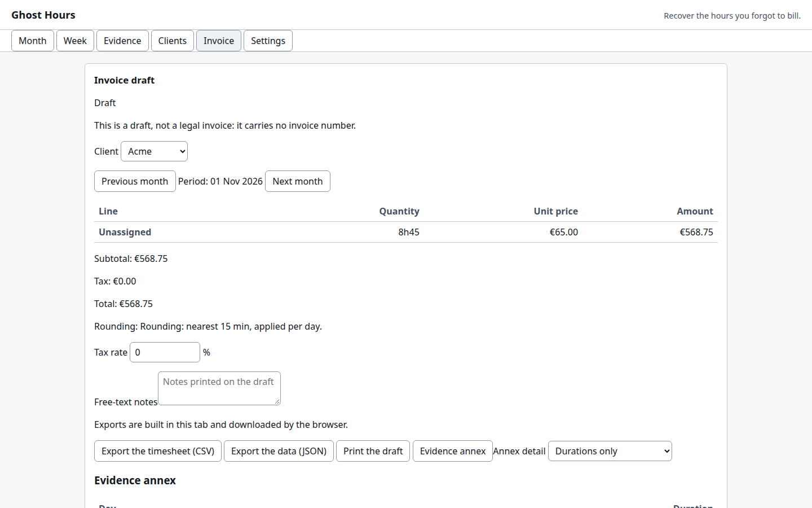

# Ghost Hours

**Reconstruct the hours you actually worked — then draft the invoice.**

Independents bill by the hour or by the day, and they forget. On the 30th, Sofia rebuilds her month
from memory and reaches 92 hours. Her commits, her calendar and her notes show 104. The missing 12
hours are *ghost hours*: worked, never billed. At €65 an hour that is €780 this month.

Ghost Hours stitches together four worlds that never talk to each other — Git history, an iCalendar
agenda, dated Markdown notes and manual entries — and proposes blocks of time per client. You
confirm, adjust, split or reject each block; only confirmed blocks can be billed, and every billed
hour links back to the evidence that supports it. Everything happens in your browser: no account,
no server, no network call after the page loads.

Built for the [Kiroween 2026](https://kiroween.devpost.com/) hackathon, **Frankenstein** category.

## Try it

**<https://baptistefaisy.github.io/ghost-hours/>** — click **Load the sample month**. It loads a
fictitious November for a fictitious freelancer with three clients and shows:

> **104 h found · 92 h declared · 12 ghost hours · €780**

The month also holds one contradiction (two commits during another client's meeting) and three
blocks whose evidence is thin, so every state the reviewer has to tell apart is on screen. Those
numbers are not typed anywhere: `fixtures/sample-month/sample-month.test.ts` recomputes them
through the real pipeline, so they cannot drift from the product.

### And a real month, one click away

**Load a real month (anonymized)** loads October 2026 as it actually happened on the author's machine: 977 proofs
collected by this project's own collector across three repositories, then passed through
`scripts/anonymize-evidence.mjs`.

> **34.2 h found · 13 working days · 21 blocks · 7 contradictions · nothing declared**

Every instant, gap and volume is genuine. Repository names, branches, remotes, local paths and the
author address are pseudonyms, and no commit message was ever read (`--no-summaries`). Nothing is
declared in it, so the ghost hours appear only once the reader types what they remember working —
which is the whole point of the product. Being real has consequences a fixture would not dare: the
three projects ran in parallel, so **seven contradictions are genuine** (18.4 hours two projects
claim at once — the same evidence read as one client says 52.6 h), and 12 of the 21 blocks rest on
thin evidence. `fixtures/real-month/real-month.test.ts` recomputes every figure through the real
pipeline **and** fails if one identifying string survives. Details and the exact procedure:
[`fixtures/real-month/`](fixtures/real-month/README.md).

## Run it locally

```bash
pnpm install
pnpm dev            # http://localhost:5173
pnpm test           # 422 tests: unit + property (Vitest, fast-check)
pnpm typecheck      # TypeScript, strict
pnpm lint           # ESLint, including the 500-line and 50-line budgets
pnpm build          # static site in apps/web/dist
```

Node.js 22 or later, pnpm 9.

## Collect your own evidence

The collector is a read-only CLI: it walks directories, finds Git repositories, reads the commits of
one author across **all references** plus the reflog, and writes `evidence.json`. It never writes to
a repository — and that is a test, not a promise (see `docs/ACCEPTANCE.md`).

```bash
node packages/collector/bin/ghost-hours.mjs collect ~/code \
  --author you@example.com --since 2026-11-01 --out evidence.json
```

Then open **Settings → Import your own evidence** and drop `evidence.json`, your `.ics` export and
your Markdown notes on the page — or use the three labelled file inputs if you prefer. Files are
sorted by what they are, unreadable ones are named with the reason, and nothing is uploaded: every
byte is parsed inside the tab. Recurring meetings are expanded, all-day and cancelled events are
set aside and reported.

## What it looks like

| The month | The week | The draft |
|---|---|---|
|  |  |  |

The month counter, the week grid and the draft are recomputed from the evidence on every change;
the figures above are the fictitious month's, asserted by `fixtures/sample-month/sample-month.test.ts`.

## How it is put together

| Package | Role |
|---|---|
| `packages/core` | Domain types, Zod schemas, DST-safe time helpers, deterministic ids |
| `packages/intervals` | Interval algebra (union, difference, coverage) — the base of every property test |
| `packages/ics` | RFC 5545 subset reader: recurrences, time zones, exceptions |
| `packages/notes` | Dated Markdown notes: timestamps, client tags |
| `packages/mapping` | Rules that attach evidence to a client, and orphan detection |
| `packages/sessionizer` | The reconstruction algorithm: sessions, lead-ins, meetings, overlaps, confidence |
| `packages/billing` | Rounding, three billing modes, caps, invoice draft, evidence annex, exports |
| `packages/collector` | Read-only Git collector (CLI) |
| `apps/web` | Static Vite + React app: month, week, evidence, clients, invoice, settings |
| `fixtures/sample-month` | The fictitious month used by the demo and by the acceptance tests |

Design notes: [`docs/ARCHITECTURE.md`](docs/ARCHITECTURE.md).
Acceptance checklist: [`docs/ACCEPTANCE.md`](docs/ACCEPTANCE.md).
Continuous integration: [`docs/CI.md`](docs/CI.md).

## How it avoids inflating the hours

The strongest objection to this product is that it could be a machine for inflating invoices. The
answer is not a disclaimer: it is a set of invariants, each one implemented and tested. The tool
proposes, the human confirms — and here is what keeps the proposals honest.

- **Only hand-confirmed blocks are billable.** `proposed`, `conflict` and `rejected` blocks are
  invisible to billing, in every mode; the output stays a `Draft`, with no invoice number —
  `packages/billing/src/blocks.ts`, `packages/billing/src/draft.ts`.
- **Assumed lead-ins are bounded, never extrapolated.** The assumed warm-up before a first proof is
  30 min by default, clamped by the previous proof and by `workdayStart`, inside a 120-min window;
  nothing is added after the last proof (`tailMinutes` defaults to 0) —
  `packages/sessionizer/src/sessions.ts`, defaults in `packages/core/src/settings.ts`, bound locked
  by property HEU-P-07 in `packages/sessionizer/src/properties.test.ts`.
- **Every assumed minute is visible.** Each block carries its `provenShare` and its
  `assumedLeadInMinutes`, graded solid ≥ 0.8 / likely ≥ 0.5 / to-confirm —
  `packages/core/src/types.ts`, `packages/sessionizer/src/blocks.ts`.
- **Breaks are not billed.** A hole longer than `breakMaxMinutes` (60) splits the session: lunch
  stays lunch — `packages/sessionizer/src/sessions.ts`.
- **No day exceeds a day.** A client is never billed more than one day per calendar day, and days
  over-booked across clients are flagged, not merged — `packages/billing/src/caps.ts`; property
  HEU-P-02 in `packages/sessionizer/src/properties.test.ts`.
- **Bots are set aside — and listed.** Dependency bots, merge queues and CI commits never count as
  proof, but they land in `ignoredEvidence`: a filter that hides what it dropped is a filter nobody
  can audit — `packages/sessionizer/src/noise.ts`, shown in `apps/web/src/screens/Settings.tsx`.
- **Contradictions are never settled by the product.** An overlap between two clients becomes a
  `conflict` block, unbillable until a human picks one of three gestures: keep one side, keep the
  other, or share the minutes — `apps/web/src/screens/Conflicts.tsx`, `apps/web/src/state/store.tsx`.
- **The bulk gesture stays prudent.** *Confirm everything solid* confirms only the `proposed`
  blocks whose proven share reaches 0.8; everything else stays queued for review —
  `apps/web/src/screens/Month.tsx`, `apps/web/src/state/store.tsx`.
- **Every decision leaves a chained trace.** Each audit entry hashes the previous fingerprint, so a
  line edited or removed afterwards breaks the chain — `apps/web/src/state/audit.ts`.
- **Nothing leaves the machine.** No network request after the page loads, no account, no server —
  enforced in CI and on save by `scripts/check-no-network.mjs` (HEU-N-01).

What it never does: round up by default (the rule is `nearest`, 15 minutes, per day —
`packages/core/src/settings.ts` — and it is printed on the draft, `packages/billing/src/rounding.ts`),
invent time no source supports, bill a conflict, or present the draft as an invoice. These rules
live in `.kiro/steering/prudence.md`, and the read-only `prudence-reviewer` agent checks them.

## How it was built with Kiro

The `.kiro/` folder is part of the product, not decoration:

- **10 steering files** — the rules the code actually follows (instants only, money in integer
  cents, no file over 500 lines, no network after load, no real client data, never inflate a bill).
  Four are domain-scoped with `fileMatch`: `time.md`, `evidence-format.md`, `ui.md`, `contest.md`.
- **6 specs** — `collector`, `ics-import`, `intervals`, `sessionizer`, `billing`, `review-ui`, each
  with EARS requirements carrying the `HEU-F-nn` identifiers of the specification, a design and a
  task list.
- **5 hooks** — the interval properties run on every save in `packages/{intervals,sessionizer}`; a
  fixture privacy guard; a no-network guard; a journal reminder after a spec task; a guard that
  refuses to let `.kiro` be gitignored. Four of the five are shell commands, which cost no credits.
- **3 custom agents** — `time-reviewer` and `prudence-reviewer` (read-only reviewers) and
  `property-tester` (turns a fast-check counterexample into a named test).
- **2 skills** — `sample-month` and `property-hunt`.

The running log is [`KIRO_JOURNAL.md`](KIRO_JOURNAL.md), with the eight questions of the submission
form. Numbers that can only be measured inside a Kiro session are marked `TODO(measure)` rather
than invented.

## Privacy

- No network request after the page loads; the evidence stays in IndexedDB (with a `localStorage`
  fallback) and can be erased from the Settings screen.
- No real client data in this repository. The fictitious month uses `example.com` / `example.org`
  addresses and invented companies. The **real** month is anonymized before it enters the tree:
  `scripts/anonymize-evidence.mjs` replaces every repository name, remote, branch, local path,
  author address and evidence id with a pseudonym under `.invalid` (RFC 2606), refuses a file that
  still carries a commit message, and prints its mapping on stdout only — never into the repository.
  `fixtures/real-month/real-month.test.ts` enforces that, and `scripts/check-privacy.mjs` re-checks
  every domain in the tree in CI.
- The optional model-assisted suggestion (HEU-F-10) is not wired in: the client suggestion for an
  orphan piece of evidence is purely heuristic, so there is a non-model path for everything.

## Dependencies and licences

Runtime: `react`, `react-dom` (MIT), `zod` (MIT). Build and test: `typescript` (Apache-2.0), `vite`
(MIT), `vitest` (MIT), `fast-check` (MIT), `esbuild` (MIT), `eslint` and its plugins (MIT),
`@testing-library/*` (MIT). No GPL or AGPL dependency, and the `.ics` reader is written here rather
than borrowed, so there is no copyleft question at all. The collector needs nothing beyond Node and
`git`. The complete list is in `pnpm-lock.yaml`.

## Pre-existing code

Every line of application code in this repository was written during the submission period; the
repository was created on 11 November 2026. The CI scaffolding under `.github/` (the `couche0`
scope guard, the merge sweeper and the conflict agent) and `.mergify.yml` are adapted from the
author's own open-source pipeline used in other repositories. They contain no application code.

## Licence

MIT — see [LICENSE](LICENSE).
